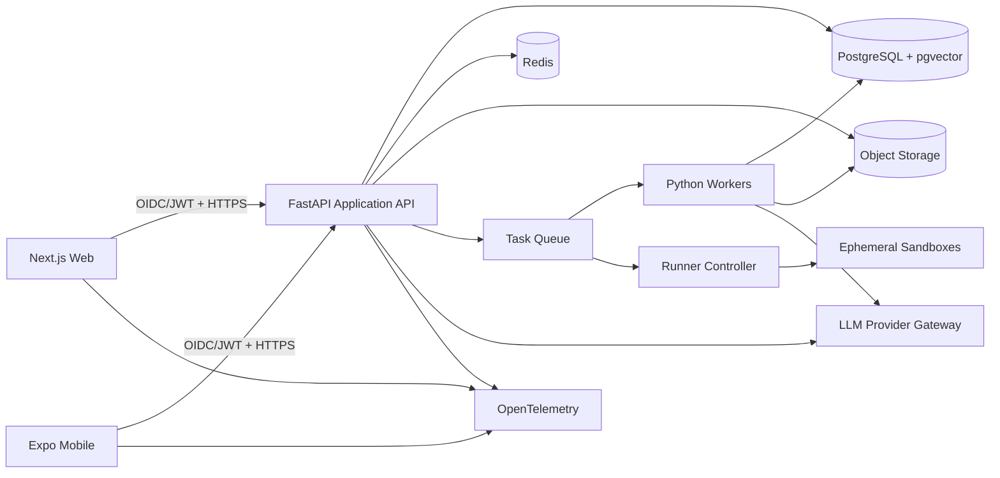

# Full-Stack E-Learning Platform: Architecture, Product Blueprint, and Engineering Curriculum

**Prepared:** 11 November 2026  
**Revision 2:** Reviewed against 31 supplied ALX project HTML files; see Section 12 and the companion reference review.  
**Reference repository:** `gpis-school-system` at commit `d4e7eba`  
**Purpose:** A production-grade capstone that teaches rigorous JavaScript/TypeScript and Python engineering while being built.

---

## 1. Executive architectural decision

Build the platform as a **modular monorepo with a Next.js web client, an Expo React Native mobile client, a FastAPI application API, Python background workers, PostgreSQL, Redis, and a separately isolated code-execution service**.

Keep the best GPIS habits:

- domain modules rather than feature logic scattered through pages;
- server-side authorization before data access;
- database constraints and RLS as authoritative controls;
- temporal and immutable records for facts that change over time;
- transactional, idempotent workflows;
- explicit decision records and business rules;
- server-rendered pages by default and client components only for interaction;
- mobile-first UI and one shared design system.

Correct the patterns that would limit a larger learning platform:

- do not make hundreds of PostgreSQL functions the primary application layer;
- do not allow route components or domain files to grow beyond a coherent responsibility;
- use generated API/database types and schema validators rather than repeated manual parsing;
- use standard test layers—unit, integration, contract, end-to-end, security, and load tests—rather than relying heavily on source-string assertions;
- run the test suite in CI;
- treat arbitrary code execution as an isolated security product, never as an ordinary API endpoint;
- version course content, exercises, prompts, rubrics, and publications from the first release.

The platform should begin as a **modular monolith**, not microservices. The web app, API, worker, and runner are separate deployable processes because they have different runtimes and security boundaries. Business domains remain modules within the FastAPI service until measured scale or team ownership justifies extraction.

---

## 2. GPIS repository analysis

### 2.1 Audit scope

The repository contains **1,507 tracked files**:

| Area | Files | Architectural role |
|---|---:|---|
| `src/` | 745 | Next.js application, components, and TypeScript domains |
| `scripts/` | 329 | offline, browser, migration, database, workflow, and regression tests |
| `supabase/` | 223 | 195 SQL migrations, configuration, and Edge Functions |
| `docs/` | 185 | decisions, business rules, deployment records, UX specifications |
| root/config/public | 25 | build, CI, package, assets, and repository instructions |

Language distribution includes 549 TypeScript files, 360 TSX files, 197 SQL files, 175 MJS files, and 102 Markdown files. I inventoried all tracked paths, exports, route boundaries, migrations, and dependency groups, then read the architectural entry points and representative implementation files in each domain.

### 2.2 Root files and governance

| File or directory | Finding | Lesson for the new platform |
|---|---|---|
| `AGENTS.md` | Acts as a strong engineering constitution: security, temporal modeling, UI, migration, and environment rules. | Create an engineering handbook, but separate permanent engineering policy from product-specific decisions. |
| `docs/DECISIONS.md` | More than 200 chronological owner decisions. It preserves why workflows exist. | Keep ADRs and product decision records; add status, supersession links, and domain tags so they remain searchable. |
| `docs/BUSINESS_RULES.md` | Captures recovered domain behavior and provenance. | For learning logic, document mastery, grading, completion, certification, and AI boundaries before implementation. |
| `README.md` | Detailed current-state and operational documentation. | Maintain a short onboarding README and move deep operational material into versioned docs. |
| `package.json` | Next.js 16, React 19, TypeScript, Supabase SSR, Tailwind 4, Radix/shadcn, Excel and print dependencies. | Preserve this web stack; add a workspace manager, test frameworks, schema validation, observability, and generated clients. |
| `tsconfig.json` | Strict TypeScript and `@/*` alias; `allowJs` and `skipLibCheck` reduce strictness at the boundaries. | Use strict mode, disable `allowJs` for application packages, and progressively eliminate `skipLibCheck`. |
| `next.config.ts` | Security headers and Chromium trace configuration. | Centralize headers, CSP, uploads, and runtime policies; allow only capabilities a screen actually needs. |
| `.github/workflows` | Guards secrets/RLS, then lints, builds, and type-checks. The repository test suite is not run. | CI must execute unit, integration, migration, and browser smoke tests before merge. |

### 2.3 Application structure

The code is a **Next.js App Router modular monolith**.

- `src/app/(app)` contains authenticated product routes.
- `src/app/(setup)` isolates mandatory first-login setup.
- `src/app/api` contains export, import, photo, PDF, workbook, report, and activity handlers.
- Server Components load data after explicit auth checks.
- Client Components are used for forms, dialogs, grids, autosave, camera handling, and navigation guards.
- There are 46 server-action files and 146 client-component files.
- `src/components/ui` is the shared shadcn/Radix layer.
- `src/components/print` provides a shared print identity and browser/PDF behavior.
- `src/lib/<domain>` holds parsing, authorization, queries, calculations, and orchestration.

The domain sizes show where complexity accumulated:

| Domain | Files | Approx. lines | Observation |
|---|---:|---:|---|
| assessments | 38 | 9,599 | Richest workflow; state, entry, imports, reports, and issuance are tightly coupled. |
| documents | 31 | 6,058 | Good domain ownership, but issuance/store files exceed 900–1,000 lines. |
| finance | 32 | 4,689 | Ledger-oriented and transaction-aware; a useful model for immutable records. |
| import | 18 | 3,520 | Strong preview/validate/confirm pattern. |
| students | 30 | 3,389 | Separates registry, profile, lifecycle, photos, history, and corrections. |
| academic | 18 | 2,173 | Temporal periods and class identity are modeled deliberately. |
| dashboard | 16 | 2,040 | Capability-driven aggregation, but the main view exceeds 1,000 lines. |
| reports | 4 | 1,850 | Too much behavior concentrated in a few files. |
| records | 3 | 1,747 | Similar concentration risk. |

The new platform should preserve domain ownership while setting a practical review threshold: around 300 lines for ordinary modules and 500 only when cohesion is clear. Crossing the threshold should trigger decomposition, not automatic rejection.

### 2.4 Routing conventions

GPIS uses route groups and nested resources consistently:

- resource lists: `/students`, `/classes`, `/assessments`;
- resource detail: `/students/[id]`, `/classes/[classId]`;
- sub-workflows: `/students/[id]/report-card`, `/assessments/class/[classId]/monthly`;
- administrative setup: `/settings/academic/...`;
- API resources mirror workflow ownership: `/api/assessments/...`, `/api/finance/...`;
- role-specific experiences use separate route families such as `/my-class` and `/finance`.

For the learning platform, use the same readable nesting while avoiding role names in core resource URLs. Prefer `/learn`, `/courses/[slug]`, `/studio/[lessonId]`, `/projects/[id]`, and `/analytics`; render capabilities according to authorization. Reserve `/admin` and `/author` for genuinely different tools.

### 2.5 Authentication and authorization

The authentication flow is unusually careful:

1. A school username is normalized in a server action.
2. A protected Supabase Edge Function maps the opaque identifier to an internal email, performs rate/lockout accounting, and calls password auth.
3. The server installs the returned Supabase session.
4. `getClaims()` is called before protected database access.
5. Roles come from verified `app_metadata`, never writable `user_metadata`.
6. First-login setup and live profile state are checked.
7. Page gates redirect; actions and database policies repeat authorization.
8. Privileged account operations run in Edge Functions because they require Auth Admin privileges.

Role helpers (`staffRole`, `isAdministrator`, finance capability functions) and route gates (`requireAdmin`, `requireFinance`, `requireAssessmentsAccess`) make authorization visible at the call site. The database repeats the boundary through RLS and functions.

For the new platform:

- use Supabase Auth for web and mobile identity;
- support email/password and selected OAuth providers rather than synthetic internal emails;
- validate JWTs in FastAPI against Supabase JWKS;
- use short-lived access tokens and rotated refresh tokens;
- store roles and entitlements in PostgreSQL; use JWT claims as a cache, not the only authority;
- define `learner`, `mentor`, `reviewer`, `instructor`, `content_author`, and `platform_admin` capabilities;
- use object-level checks for enrollment, cohort, ownership, and publication state;
- place all writes behind FastAPI application services; Next.js is not a second business backend.

### 2.6 Database model and transaction style

The local reconstructed schema has **77 public tables, 173 RLS policies, 368 triggers, and 642 public functions**. All public tables have RLS enabled. Core relationship patterns include:

- `profiles` → role and account state;
- `students` → identity only;
- `enrolments` → temporal class membership;
- `academic_years`, `terms`, `classes`, `academic_year_classes` → period-specific structure;
- `subject_offerings` → a subject offered to a class in a year;
- `assessments` → references the enrollment under which a score was earned;
- `assessment_subject_workflows` and send-back tables → aggregate workflow state and immutable history;
- `charges`, `payments`, `payment_allocations`, scholarships, and adjustments → ledger-oriented finance;
- `issued_documents` → immutable snapshots and verification provenance;
- `audit_events` → actor and before/after history.

The most valuable pattern is temporal truth: a changing fact is represented by a dated relationship rather than overwritten on the entity. The e-learning equivalent is that an attempt must reference the exact published exercise/content version, and a certificate must reference the completion snapshot it certified.

The main risk is that business logic has migrated too far into SQL: 195 migrations contain hundreds of functions and triggers. This protects invariants, but it raises migration risk, makes discovery difficult, and duplicates TypeScript concepts. For the capstone:

- keep constraints, foreign keys, uniqueness, RLS, and short atomic database procedures in PostgreSQL;
- keep workflow orchestration in Python application services;
- use SQLAlchemy 2 and Alembic for schema evolution;
- use PostgreSQL functions only for operations that must execute atomically next to the data;
- use an outbox table for reliable asynchronous events;
- generate ER diagrams and migration documentation in CI.

### 2.7 Validation and error handling

GPIS generally uses discriminated unions such as `{ok: true, ...} | {ok: false, error: ...}` and custom `parse*.ts` modules. Client validation is repeated in server actions and database constraints. This is sound in principle, but there is no Zod dependency or usage, and manually synchronized validators are expensive.

Use:

- Pydantic v2 as the API request/response authority;
- generated OpenAPI TypeScript clients;
- Zod only at browser-only boundaries such as local forms, files, and untrusted editor state;
- typed domain exceptions mapped once to Problem Details (`application/problem+json`);
- database constraints as the final invariant layer.

### 2.8 Testing and delivery

The repository has broad domain coverage and a useful custom runner. Tests include pure functions, source structure, migration replay, PGlite/local Supabase database behavior, browser tests, workbook serialization, and workflow preservation. This shows excellent regression awareness.

The weaknesses are:

- many assertions inspect source text rather than behavior;
- no mainstream unit/e2e framework coordinates fixtures, coverage, retries, and reporting;
- live tests are intentionally separate, but CI does not run the main offline suite either;
- environment requirements make some database tests easy to skip;
- snapshot/hash preservation can resist legitimate refactoring.

Adopt:

- Vitest + React Testing Library for TypeScript units/components;
- Pytest for Python domain and API tests;
- Testcontainers for PostgreSQL/Redis integration tests;
- Playwright for critical web journeys and accessibility checks;
- Maestro or Detox for a small mobile smoke suite;
- Schemathesis or generated OpenAPI contract tests;
- k6 for runner and API load tests;
- mutation tests on grading/mastery logic where justified;
- CI coverage gates on critical domains, not arbitrary whole-repo percentages.

---

## 3. Target product and bounded contexts

### 3.1 Product modes

The product blends three learning modes:

- **Codecademy:** immediate interactive exercises, code checks, streaks, and skill practice;
- **ALX:** cohort accountability, project milestones, peer review, deadlines, and engineering rigor;
- **Coursera:** structured courses, video/text lessons, quizzes, certificates, and instructor analytics.

The differentiator is an evidence-based engineering path: every lesson maps to skills, every submission records an immutable attempt against a version, analytics explain weak points, and AI assistance is cited, constrained, and evaluated.

### 3.2 Bounded contexts

1. **Identity and Access** — profiles, auth identities, roles, consent, sessions, account lifecycle.
2. **Catalog and Curriculum** — programs, courses, versions, modules, lessons, prerequisites, skill graph.
3. **Enrollment and Cohorts** — enrollment, cohort membership, schedules, mentors, deadlines.
4. **Learning Delivery** — lesson blocks, media, checkpoints, bookmarks, notes, progress.
5. **Assessment** — quizzes, code exercises, projects, rubrics, attempts, reviews, mastery.
6. **Code Execution** — job acceptance, sandbox provisioning, tests, logs, resource accounting.
7. **Analytics** — event ingestion, daily facts, weekly reports, skill mastery, recommendations.
8. **AI Learning Assistant** — prompt registry, RAG sources, conversations, citations, evaluations.
9. **Portfolio and Publishing** — milestone evidence, portfolio entries, blog drafts, revisions, public pages.
10. **Notifications** — in-app/email/push preferences, scheduled reminders, delivery records.
11. **Content Operations** — authoring, preview, review, publication, rollback, audit.

Do not start with separate services for each context. Implement them as Python packages with explicit public interfaces and separate database schemas or table prefixes only where useful.

---

## 4. System architecture



### 4.1 Monorepo layout

```text
learning-platform/
├── apps/
│   ├── web/                  # Next.js App Router, TypeScript
│   └── mobile/               # Expo + React Native, TypeScript
├── services/
│   ├── api/                  # FastAPI modular monolith
│   ├── worker/               # Celery workers and scheduled jobs
│   └── runner-controller/    # accepts signed jobs, provisions sandboxes
├── packages/
│   ├── ui/                   # shared design tokens and web primitives
│   ├── mobile-ui/            # mobile-specific primitives using same tokens
│   ├── contracts/            # generated OpenAPI TypeScript client/types
│   ├── config/               # ESLint, TypeScript, formatting, env schemas
│   └── telemetry/            # shared event names and client instrumentation
├── content/
│   ├── curriculum/           # versioned lesson source and metadata
│   ├── exercises/            # exercise specs and public tests
│   └── prompts/              # versioned prompt templates and eval cases
├── infra/
│   ├── docker/               # local development
│   ├── terraform/            # hosted infrastructure when needed
│   └── monitoring/
├── docs/
│   ├── adr/
│   ├── product-decisions/
│   ├── threat-models/
│   ├── runbooks/
│   └── diagrams/
└── .github/workflows/
```

Use `pnpm` workspaces for JavaScript packages and `uv` for Python environments. Use a root `Makefile` or `justfile` as the human-facing command layer.

### 4.2 Deployment boundaries

- **Web:** Vercel or a Node container.
- **Mobile:** Expo EAS builds and stores.
- **API/worker:** containers on Fly.io, Render, Railway, ECS, or Kubernetes later.
- **Database/Auth/Storage:** Supabase initially.
- **Redis:** managed Redis.
- **Runner:** separate isolated compute account/project; never the API host.
- **CDN/video:** object storage plus signed CDN URLs; use an external video processor initially.

### 4.3 API rules

- REST first, OpenAPI generated by FastAPI.
- `/v1` from the beginning.
- Cursor pagination for activity, catalog, attempts, and events.
- Idempotency keys on submissions, enrollments, publications, and payment-like operations.
- Optimistic concurrency through `version`/ETag on authored content and learner drafts.
- Problem Details errors with stable machine codes.
- Server-Sent Events for one-way runner output and AI streaming; authenticated WebSockets for bidirectional terminal input/output, resize, and reconnect. Authorize each connection against its workspace lease and owner.
- No database calls from React components. The API is the business boundary.

---

## 5. Core data model

### 5.1 Identity

- `profiles(id, display_name, headline, bio, timezone, locale, avatar_key, onboarding_state)`
- `roles(id, key)`
- `profile_roles(profile_id, role_id, scope_type, scope_id, starts_at, ends_at)`
- `consents(profile_id, policy_version, accepted_at)`
- `audit_events(id, actor_id, action, resource_type, resource_id, before_json, after_json, occurred_at)`

### 5.2 Curriculum and publication

- `programs`
- `courses`
- `course_versions(course_id, version, status, published_at, changelog)`
- `modules(course_version_id, position, title)`
- `lessons(module_id, position, lesson_type, estimated_minutes)`
- `lesson_versions(lesson_id, version, content_json, status, checksum)`
- `lesson_blocks(lesson_version_id, position, block_type, payload_json)`
- `skills(id, key, name, parent_skill_id)`
- `lesson_skills(lesson_version_id, skill_id, target_level, weight)`
- `course_prerequisites(course_id, prerequisite_course_id, rule_json)`
- `assets(id, object_key, media_type, checksum, processing_state)`

Published versions are immutable. Corrections create a new version; active enrollments retain an explicit version policy.

### 5.3 Enrollment and schedules

- `enrollments(id, learner_id, course_id, course_version_id, status, enrolled_at, completed_at)`
- `cohorts(id, program_id, name, starts_at, ends_at)`
- `cohort_memberships(cohort_id, learner_id, role, starts_at, ends_at)`
- `deadlines(id, cohort_id, resource_type, resource_id, due_at, grace_rule_json)`
- `mentor_assignments(mentor_id, cohort_id, starts_at, ends_at)`

Like GPIS enrollment history, never store “current course/module” as an authoritative field on the profile. Derive it from enrollment and progress facts.

### 5.4 Progress and attempts

- `learning_sessions(id, learner_id, started_at, ended_at, device_type)`
- `lesson_progress(enrollment_id, lesson_version_id, state, first_opened_at, completed_at, last_position, version)`
- `learning_events(id, learner_id, enrollment_id, event_type, resource_type, resource_id, occurred_at, payload_json)`
- `exercises(id, lesson_id, kind)`
- `exercise_versions(exercise_id, version, prompt, starter_files_json, runtime, limits_json, status)`
- `test_cases(exercise_version_id, visibility, position, input_json, expected_json, weight)`
- `attempts(id, learner_id, enrollment_id, exercise_version_id, attempt_no, submitted_at, answer_json, status)`
- `attempt_results(attempt_id, score, passed, feedback_json, runtime_ms, memory_bytes, runner_version)`
- `projects`, `project_versions`, `project_milestones`
- `project_submissions`, `rubrics`, `rubric_versions`, `reviews`, `review_scores`

An attempt is append-only. A retry creates another attempt. Never overwrite evidence.

### 5.5 Mastery and analytics

- `skill_evidence(id, learner_id, skill_id, source_type, source_id, score, weight, observed_at)`
- `skill_mastery(learner_id, skill_id, level, confidence, calculated_at, algorithm_version)`
- `daily_learning_facts(learner_id, day, active_minutes, lessons_completed, attempts, points)`
- `streaks(learner_id, current_days, longest_days, last_qualified_day)`
- `weekly_reports(id, learner_id, week_start, snapshot_json, generated_at)`
- `recommendations(id, learner_id, kind, reason_codes, resource_id, model_version, state)`

Store raw events and derived facts separately. Derived values are reproducible and carry an algorithm version.

### 5.6 AI and RAG

- `knowledge_sources(id, course_version_id, source_type, checksum, status)`
- `knowledge_chunks(id, source_id, ordinal, text, metadata_json, embedding vector)`
- `ai_conversations`, `ai_messages`
- `prompt_templates(id, key, version, system_text, tool_policy_json, status)`
- `ai_runs(id, learner_id, prompt_version, model, input_hash, output_json, citations_json, cost, latency_ms)`
- `ai_evaluations(run_id, evaluator, score, findings_json)`

Do not let an LLM decide authorization, final grades, certificates, or whether tests passed. AI may explain and recommend; deterministic systems decide.

### 5.7 Portfolio and publishing

- `portfolio_profiles(learner_id, slug, theme, visibility)`
- `portfolio_entries(id, learner_id, project_submission_id, title, summary, skills_json, visibility)`
- `blog_posts(id, learner_id, slug, status)`
- `blog_revisions(post_id, version, title, markdown, source_evidence_json, created_by, created_at)`
- `publication_jobs(id, target, state, idempotency_key, result_url)`

AI creates a draft tied to verified milestone evidence. The learner edits and explicitly publishes it. Publishing is never automatic.

### 5.8 Important constraints and indexes

- unique course slug and version tuples;
- immutable published lesson/exercise/rubric versions;
- unique `(learner_id, exercise_version_id, attempt_no)`;
- unique `(enrollment_id, lesson_version_id)` progress row;
- partial indexes for active enrollments and pending jobs;
- GIN indexes for JSON only where query evidence exists;
- vector index after measuring corpus size and recall;
- monthly partitioning for `learning_events` only when table size warrants it;
- foreign keys with intentional delete behavior—mostly restrict or soft-retire, rarely cascade;
- checks for score ranges, status transitions, and resource limits;
- outbox record written in the same transaction as state-changing workflows.

---

## 6. Key screen wireframes

### 6.1 Dashboard and Course Catalog

```text
┌──────────────────────────────────────────────────────────────────────┐
│ LearnForge    Search courses...       12-day streak 🔥   Avatar ▾   │
├───────────────┬──────────────────────────────────────────────────────┤
│ Home          │ Good morning, Ama                                    │
│ My learning   │ Continue where you stopped                           │
│ Catalog       │ ┌──────────────────────────────────────────────────┐ │
│ Projects      │ │ Full-Stack Foundations          42%  ◔           │ │
│ Analytics     │ │ Async JavaScript · 18 min left                  │ │
│ Portfolio     │ │ [Continue lesson]                               │ │
│               │ └──────────────────────────────────────────────────┘ │
│               │                                                      │
│               │ This week              Skill health                  │
│               │ 4h 35m · 7 lessons     JS ███████░ 72%              │
│               │ 18 exercises · 82%     SQL █████░░░ 51%             │
│               │                                                      │
│               │ Roadmap                                              │
│               │ ● Foundations ─ ● JS/TS ─ ◐ Python ─ ○ Frontend ... │
│               │                                                      │
│               │ Recommended next                                    │
│               │ [Promises Lab] [SQL Index Clinic] [HTTP Debugging]  │
└───────────────┴──────────────────────────────────────────────────────┘
```

Mobile becomes one column with a bottom bar: Home, Learn, Practice, Progress, More. The active course card appears first. Progress rings always include a numeric label and accessible text. The catalog has filters for path, level, duration, skill, project type, and free/enrolled status. Course cards show prerequisites and outcomes, not marketing-only descriptions.

### 6.2 Interactive Learning Studio

```text
┌──────────────────────────────────────────────────────────────────────┐
│ ← Module 2   Closures and lexical scope   5/12   Notes   Help       │
├───────────────────────────────┬──────────────────────────────────────┤
│ LESSON                         │ EXERCISE                             │
│ [Text] [Video] [Transcript]   │ main.ts                             │
│                               │ ┌──────────────────────────────────┐ │
│ A closure retains access...   │ │ const makeCounter = () => {     │ │
│                               │ │   // your implementation         │ │
│ Visual call-stack diagram     │ │ }                                │ │
│                               │ └──────────────────────────────────┘ │
│ Checkpoint question           │ [Run] [Submit]       Tests 2/4      │
│ Why does count survive?       │ ┌ Console ────────────────────────┐ │
│                               │ │ Test 3: independent counters... │ │
│ [Hint 1] [Ask AI with context]│ └──────────────────────────────────┘ │
├───────────────────────────────┴──────────────────────────────────────┤
│ Previous              Saved 10:42              Next after passing   │
└──────────────────────────────────────────────────────────────────────┘
```

Desktop supports resizable panes. Tablet uses tabs. Mobile shows Lesson, Code, and Output tabs with persistent run/submit actions. The editor autosaves a draft locally and to the API with revision checks. “Run” uses public tests and is cheap; “Submit” creates an immutable attempt and executes hidden tests. AI sees the lesson, learner code, failed-test summaries, and allowed course sources, but never hidden expected outputs.

For prompt/architecture exercises, the right pane becomes a structured response editor with rubric checks. For frontend exercises, it includes code, console, tests, and an isolated preview frame.

### 6.3 Analytics and Weekly Reporting Hub

```text
┌──────────────────────────────────────────────────────────────────────┐
│ Progress & Analytics          Week of 9 Nov ▾     Export report     │
├──────────────────────────────────────────────────────────────────────┤
│ Consistency 5/7 days │ Focus 6h 20m │ Accuracy 78% │ Velocity +12% │
├──────────────────────────────────────┬───────────────────────────────┤
│ Activity trend                       │ Skill mastery                 │
│ 90m ┤       ╭─╮                      │ Async JS        74% ↑         │
│ 60m ┤  ╭─╮  │ │ ╭╮                   │ SQL joins       81% ↑         │
│ 30m ┤╭─╯ ╰──╯ ╰─╯╰                   │ Indexing        43% ↓         │
│     └ M T W T F S S                  │ HTTP caching    48% →         │
├──────────────────────────────────────┴───────────────────────────────┤
│ Weak points                                                        │
│ 1. Composite indexes: 3 repeated errors across 2 labs              │
│ 2. Promise error propagation: hints used before 4/5 attempts       │
│                                                                    │
│ Recommended plan                                                   │
│ Tue: Index Clinic (25m)  Wed: Retry Promise Lab (20m)              │
│ Reason: based on attempts #31–#38 and skill evidence               │
└────────────────────────────────────────────────────────────────────┘
```

Every recommendation includes evidence and an explanation. Learners can dismiss or defer it. Instructors get cohort aggregates and can drill into a learner only within their assigned scope. Avoid “AI says you are weak”; show the deterministic evidence and let AI phrase a study plan.

### 6.4 Portfolio and Blog Generator

```text
┌──────────────────────────────────────────────────────────────────────┐
│ Portfolio Studio                     Preview public page            │
├───────────────────────────────┬──────────────────────────────────────┤
│ Eligible milestones           │ Project: Secure Task API            │
│ ☑ FastAPI task service        │ ┌──────────────────────────────────┐ │
│ ☑ PostgreSQL optimization     │ │ Problem                          │ │
│ ☐ CI/CD deployment            │ │ I needed to prevent duplicate...│ │
│                               │ │                                  │ │
│ Generate                      │ │ Architecture                     │ │
│ [Portfolio entry]             │ │ [diagram]                        │ │
│ [Technical blog draft]        │ │                                  │ │
│ Tone: Technical ▾             │ │ What I learned                   │ │
│ Evidence: commits, tests, ADR │ └──────────────────────────────────┘ │
│                               │ [Save draft] [Preview] [Publish]    │
└───────────────────────────────┴──────────────────────────────────────┘
```

Generation uses selected evidence: project brief, learner reflection, approved submission, test result summary, chosen commits, and ADRs. It must mark unsupported claims, cite evidence internally, and never invent performance numbers. Revision history and explicit publish consent are mandatory. Export targets begin with the platform’s public profile and Markdown; GitHub/Dev.to/Hashnode integrations come later.

---

## 7. Curriculum: foundations to advanced engineering

### Program format

Plan **64–72 weeks at 12–15 focused hours per week**, including integration, revision, and project defense. The eight module allocations below total 63 weeks; the remaining 1–9 weeks are contingency and consolidation. A diagnostic may shorten familiar units only after a practical mastery check. Each unit follows:

1. concept lesson;
2. guided example;
3. retrieval quiz;
4. constrained lab;
5. debugging lab;
6. independent implementation;
7. code review and written reflection;
8. mastery check.

Learners build the e-learning platform throughout the program. Every module contributes a production subsystem. Bash, SQL, HTML/CSS, and configuration files are necessary operating tools; substantial application and automation code remains JavaScript/TypeScript or Python. Section 12 defines the additional practical labs and their release gates.

### Module 1 — Computer Science and Systems Foundations (8 weeks)

**Units**

1. Binary, data representation, CPU, memory, stack/heap, processes, threads, system calls.
2. Filesystems, permissions, environment variables, streams, pipes, and shell scripting.
3. Git internals: objects, refs, branches, rebase, merge, bisect, reflog, signed commits, release tags.
4. Networking: OSI/TCP-IP models, IP, ports, TCP handshake, UDP, TLS, DNS, proxies, CDNs.
5. HTTP: methods, status codes, headers, cookies, caching, CORS, content negotiation, idempotency.
6. Linux process inspection, logs, resource measurement, and failure diagnosis.
7. Terminal editor survival, SSH key hygiene, UID/GID, directory permissions, links, quoting, exit codes, and safe shell composition.
8. Signals, graceful shutdown, child-process cleanup, loopback versus interface binding, CIDR, host resolution, and a complete browser-to-database request explanation.

**Labs**

- implement a miniature shell pipeline runner in Python;
- inspect HTTP/TLS/DNS with `curl`, `dig`, and packet captures;
- recover lost Git work and bisect a regression;
- build a raw TCP HTTP server for learning, then explain why it is not production-ready.

**Platform milestone:** repository constitution, ADR template, monorepo, local Docker environment, CI skeleton, observability baseline.

### Module 2 — JavaScript and TypeScript Mastery (8 weeks)

**Units**

1. ECMAScript values, coercion, equality, prototypes, property descriptors, modules.
2. Lexical environments, closures, `this`, call/apply/bind, functional composition.
3. Event loop, task/microtask queues, Promises, async iterators, cancellation, streams.
4. Browser and Node runtimes, module resolution, bundling, memory leaks, profiling.
5. TypeScript structural typing, narrowing, discriminated unions, interfaces vs aliases.
6. Generics, conditional/mapped/template-literal types, variance, branded types.
7. Runtime validation, API contracts, error modeling, package design.
8. Performance, testing, refactoring, and library documentation.

**Labs**

- implement Promise utilities and a concurrency-limited task pool;
- debug stale closures and race conditions;
- build a typed event bus with exhaustive event handling;
- design a generated API client and validate untrusted data;
- parse structured logs with JavaScript regular expressions, test Unicode and anchoring, and diagnose excessive backtracking.

**Platform milestone:** shared TypeScript packages, design tokens, generated FastAPI client, web shell, catalog UI, authentication client.

### Module 3 — Python Core and Backend Architecture (8 weeks)

**Units**

1. Python object model, mutability, iterators/generators, decorators, context managers.
2. Type hints, protocols, generics, dataclasses, Pydantic, static analysis.
3. Data structures, comprehensions, standard library, packaging with `pyproject.toml` and `uv`.
4. Exceptions, logging, resource cleanup, concurrency, async I/O, multiprocessing.
5. OOP, composition, dependency inversion, repositories, application services, domain events.
6. FastAPI routing, dependency injection, validation, OpenAPI, middleware.
7. SQLAlchemy units of work, transactions, Alembic, background jobs.
8. API performance, profiling, caching, resilience, and observability.

Flask is taught briefly to understand WSGI and minimal frameworks; FastAPI is the platform framework.

**Labs**

- build a typed CLI and package it;
- implement the same API poorly, measure it, and refactor into layers;
- create idempotent submission processing;
- diagnose transaction and async failures;
- consume a paginated mock API with timeouts, bounded retries, cancellation, rate limits, schema validation, and CSV/JSON export;
- repair an unfamiliar Python service with a failing regression test and a minimal patch; compare Python and JavaScript regex behavior.

**Platform milestone:** FastAPI service, profile/catalog/enrollment modules, PostgreSQL migrations, Redis, task worker, API documentation.

### Module 4 — Frontend Engineering, UI/UX, and Frameworks (8 weeks)

**Units**

1. Semantic HTML, CSS layout, cascade, responsive systems, design tokens.
2. Accessibility: keyboard, focus, landmarks, forms, ARIA restraint, contrast, reduced motion.
3. React rendering, reconciliation, composition, controlled state, effects, refs.
4. State boundaries: URL state, server state, form state, local state, caches.
5. Next.js App Router, Server Components, actions/BFF boundaries, streaming, caching.
6. Forms, optimistic UI, error recovery, offline drafts, data visualization.
7. Component testing, visual regression, performance budgets, Core Web Vitals.
8. Expo/React Native fundamentals, navigation, native permissions, offline sync.

**Labs**

- reproduce screens from accessible wireframes;
- repair a keyboard and screen-reader audit;
- profile and reduce unnecessary renders;
- build resilient autosave with optimistic concurrency.

**Platform milestone:** dashboard, catalog, course detail, responsive learning studio, accessibility baseline, Expo learner shell.

### Module 5 — Databases and Data Engineering (7 weeks)

**Units**

1. Relational modeling, keys, constraints, normalization through 3NF/BCNF, deliberate denormalization.
2. PostgreSQL types, joins, aggregates, window functions, CTEs, transactions, isolation.
3. Index structures, composite/partial/covering indexes, query plans, cardinality.
4. Temporal models, append-only events, ledgers, snapshots, versioned content.
5. SQLAlchemy ORM, query construction, N+1 problems; Prisma/Supabase comparison labs.
6. Redis caching, invalidation, queues, outbox pattern, analytics facts, retention.
7. PostgreSQL physical/logical replication, WAL, lag and stale reads, least-privilege database roles, encrypted off-site backups, and measured restore drills. Replication does not replace backups.

**Labs**

- normalize a flawed course schema;
- use `EXPLAIN ANALYZE` to fix slow queries;
- reproduce and repair a race condition;
- design event, fact, and snapshot tables.

**Platform milestone:** versioned curriculum schema, immutable attempts, progress events, mastery facts, indexes, backup/restore exercise.

### Module 6 — Security, Testing, and DevOps (10 weeks)

**Units**

1. Threat modeling, assets, trust boundaries, attacker stories.
2. OWASP Top 10: injection, XSS, CSRF, SSRF, broken access control, insecure design.
3. Passwords, OAuth/OIDC, JWT verification, sessions, RBAC/ABAC, RLS.
4. Secrets, encryption, signed URLs, supply chain, dependency and container scanning.
5. Unit, property, integration, contract, E2E, accessibility, load, and chaos testing.
6. Docker images, networks, volumes, health checks, least privilege, SBOMs.
7. CI/CD, migration safety, feature flags, canaries, rollback, environment promotion.
8. Logs, metrics, traces, SLOs, incident response, runbooks, postmortems.

**Labs**

- exploit and repair a vulnerable API;
- write an authorization matrix and negative tests;
- build a multi-stage non-root container;
- perform a zero-downtime migration and rollback drill;
- run an incident simulation with a timestamped timeline, impact evidence, contributing causes, and owned prevention tasks;
- repair Nginx-to-FastAPI routing and file-descriptor exhaustion under load;
- reconcile configuration drift twice and demonstrate that the second run makes no change;
- deploy FastAPI through an ASGI server, test restart recovery and graceful request draining, and explain the WSGI distinction.

**Platform milestone:** hardened auth, threat models, full CI, container deployment, observability, backups, rate limiting, security headers.

### Module 7 — Algorithms and Problem Solving (6 focused weeks, practiced throughout)

**Units**

1. Complexity analysis and measurement.
2. Arrays, strings, linked structures, stacks, queues, hash maps.
3. Recursion, divide and conquer, sorting, binary search.
4. Trees, heaps, tries, graphs, BFS/DFS, shortest paths.
5. Dynamic programming, greedy reasoning, backtracking.
6. Real engineering applications: scheduling, prerequisite graphs, ranking, search, caching.

Every problem requires a correctness argument, complexity analysis, tests, and an explanation of when the solution is inappropriate. Optional number-theory labs use Python integers and JavaScript BigInt for toy factorization, gcd, modular arithmetic, and bounded benchmarks. They teach cryptographic assumptions; application cryptography uses maintained libraries.

**Platform milestone:** course prerequisite graph validation, recommendation traversal, scheduling algorithm, and search/ranking benchmark.

### Module 8 — Generative AI and Prompt Engineering (8 weeks)

**Units**

1. Tokens, embeddings, transformers, attention, pretraining, fine-tuning, inference limits.
2. Sampling, context windows, hallucination, calibration, cost and latency.
3. Prompt contracts, system/developer/user hierarchy, structured output, tool definitions.
4. Embedding pipelines, chunking, retrieval, reranking, citations, pgvector.
5. Agent loops, planning, tool permissions, state, human approval, failure recovery.
6. Prompt injection, data leakage, unsafe tools, model and supply-chain threats.
7. Evaluation: golden sets, graders, deterministic checks, regression tests, A/B tests.
8. AI-assisted engineering: review, test generation, provenance, critique, and correction.

**Labs**

- implement semantic retrieval and measure recall;
- build a cited course assistant that can say “I do not know”;
- attack it with prompt injection and harden the tool boundary;
- compare AI-generated code against tests, static analysis, profiling, and manual review;
- build an evaluation dashboard before changing prompts.

**Platform milestone:** RAG tutor, evidence-based study recommendations, portfolio draft generator, prompt registry, cost controls, and evaluation suite.

### Final capstone standard

The learner ships the platform with:

- a public architecture document and threat model;
- automated deployments and rollback;
- measured performance and accessibility budgets;
- API and schema documentation;
- tests at every layer;
- an incident runbook and simulated postmortem;
- a technical blog series derived from verified milestones;
- a recorded architecture defense explaining tradeoffs and rejected alternatives.

---

## 8. Execution roadmap

The week ranges below are the original engineering sequence, not a promise that a part-time learner can finish in 28 weeks. The 64–72 week curriculum is the personal learning schedule. Scope the first pilot to text, quizzes, repository evidence, and mentor review; add hosted terminal and infrastructure labs through the separate gates in Section 12. Re-estimate those phases after the runner prototype and measured hosting costs.

### Phase 0 — Decisions and repository foundation (Week 1)

1. Create a new repository; do not place this product inside GPIS.
2. Write ADRs for the modular monolith, Supabase Auth, FastAPI, PostgreSQL, Redis, code-runner isolation, and monorepo tools.
3. Define user roles, the course publication workflow, attempt immutability, completion rules, and AI non-authority rules.
4. Create the monorepo layout, formatting, linting, type checking, pre-commit hooks, and CI.
5. Add Docker Compose for PostgreSQL, Redis, API, worker, and web.
6. Add health/readiness endpoints and a trace ID across web → API → worker.

**Exit gate:** one command boots the stack; CI validates a trivial web/API flow.

### Phase 1 — Core schema and authentication (Weeks 2–3)

1. Create migrations for profiles, roles, scoped role assignments, audit events, and outbox events.
2. Configure Supabase Auth for email/password and one OAuth provider.
3. Implement JWT verification in FastAPI using JWKS with issuer/audience validation.
4. Implement Next.js SSR session handling and Expo secure token storage.
5. Add onboarding, profile management, sign-out-everywhere, disabled-account handling, and session expiry.
6. Define authorization dependencies: `current_user`, `require_role`, resource ownership, instructor/cohort scope.
7. Add RLS for user-owned profile data and integration tests for every role/resource pair.

**Exit gate:** web and mobile can sign in; disabled or unscoped users are rejected by UI, API, and database tests.

### Phase 2 — Catalog and content publication (Weeks 4–6)

1. Build programs, courses, versions, modules, lessons, blocks, skills, and prerequisites.
2. Build author draft → preview → review → publish workflow.
3. Render text, code, callout, image, quiz, and video blocks.
4. Add signed asset upload and media processing jobs.
5. Build catalog search and course-detail pages.

**Exit gate:** an author publishes version 1; a learner sees the immutable published course; edits produce version 2.

### Phase 3 — Enrollment and progress vertical slice (Weeks 7–8)

1. Implement enrollment and optional cohort membership.
2. Add lesson sessions, progress, bookmarks, notes, and event recording.
3. Build the dashboard, roadmap, progress ring, and streak logic.
4. Create outbox-driven daily aggregates.

**Exit gate:** a learner enrolls, completes a text lesson and quiz, leaves, returns on another device, and sees correct progress.

### Phase 4 — Interactive exercise engine (Weeks 9–12)

1. Define versioned exercise and test-case contracts.
2. Build Monaco-based studio, local drafts, revision-aware autosave, run, and submit flows.
3. Implement queueing and signed runner jobs.
4. Run JavaScript/TypeScript and Python in ephemeral, network-disabled sandboxes with CPU, memory, time, process, filesystem, and output limits.
5. Store immutable attempts and results; stream bounded output through SSE.
6. Add abuse detection, quotas, cleanup, and runner versioning.

**Exit gate:** malicious submissions cannot reach the network/host, and load tests prove bounded concurrency and recovery.

### Phase 5 — Projects, rubrics, and cohort workflow (Weeks 13–15)

1. Build proposal → MVP specification → implementation plan → delivery → release/defense stages, with versioned evidence, stage criteria, rubrics, reviews, and resubmissions (Section 12).
2. Add mentor/reviewer queues and scoped cohort analytics.
3. Implement deadlines and explicit grace rules.
4. Add notification preferences and scheduled reminders.

**Exit gate:** a project moves through submit → review → changes requested → resubmit → accepted with immutable history.

### Phase 6 — Analytics and recommendations (Weeks 16–18)

1. Define event taxonomy and retention.
2. Build daily facts, skill evidence, mastery calculation, streaks, and weekly snapshots.
3. Build learner and instructor analytics screens.
4. Start with deterministic recommendations and explanation codes.

**Exit gate:** every chart reconciles to attempts/events, and recommendations show their evidence.

### Phase 7 — AI tutor and evaluation (Weeks 19–22)

1. Build source ingestion, chunking, embeddings, retrieval, reranking, and citations.
2. Add model gateway, prompt registry, budgets, redaction, and tool allowlists.
3. Build course-context chat and failed-attempt explanations.
4. Create golden evaluation sets and prompt/model regression CI.
5. Add human feedback and safety telemetry.

**Exit gate:** the assistant answers only from allowed sources, cites them, resists the threat-model prompt injections, and cannot reveal hidden tests.

### Phase 8 — Portfolio and publishing (Weeks 23–24)

1. Select verified project evidence, an accurate architecture diagram, individual contribution notes, a reviewed README, demo, and release checklist.
2. Generate editable portfolio/blog drafts.
3. Add revision history, preview, explicit publish, unpublish, and Markdown export.
4. Build accessible public portfolio pages with SEO controls.

**Exit gate:** no claim can be published without learner review, and every generated claim links to evidence in the editor.

### Phase 9 — Mobile, offline, and hardening (Weeks 25–28)

1. Complete Expo learner flows: catalog, lessons, quiz, progress, notifications, and portfolio review.
2. Add offline lesson caching and conflict-safe progress sync.
3. Perform accessibility, performance, security, recovery, and load audits.
4. Run backup restore, migration rollback, runner compromise, and provider outage drills.
5. Create SLOs, alerts, runbooks, and release checklist.

**Exit gate:** production readiness review with measured evidence, not feature-complete claims alone.

---

## 9. The first four implementation sprints

### Sprint 1: foundation

- monorepo and package boundaries;
- Docker Compose;
- FastAPI `/health/live` and `/health/ready`;
- Next.js shell;
- PostgreSQL and Alembic;
- Redis connectivity;
- OpenTelemetry trace propagation;
- CI for lint, format, typecheck, unit tests, migration replay, secret scan, dependency audit, and builds.

### Sprint 2: identity

- `profiles`, `roles`, `profile_roles`, `audit_events`, `outbox_events`;
- Supabase Auth integration;
- FastAPI JWT verification;
- Next.js SSR auth and protected layout;
- Expo login proof of concept;
- authorization matrix and negative integration tests.

### Sprint 3: course publication

- `courses`, `course_versions`, `modules`, `lessons`, `lesson_versions`, `lesson_blocks`;
- author draft and preview;
- publication transaction;
- catalog and course detail;
- immutable published-version tests.

### Sprint 4: learner vertical slice

- enroll in one course;
- open one lesson;
- complete a deterministic quiz;
- record an immutable attempt;
- update progress transactionally;
- render dashboard progress;
- emit an outbox event and build a daily fact;
- run one full Playwright journey.

Do not begin code execution or AI until this slice is reliable. The first valuable release is a trustworthy learning system with deterministic lessons, quizzes, progress, and versioning.

---

## 10. Engineering quality gates

A feature is complete only when:

- product rules and authorization are documented;
- request and response schemas are versioned;
- client, API, and database boundaries validate independently;
- migrations replay from an empty database and upgrade a representative prior version;
- role/resource negative tests exist;
- critical workflows are idempotent and concurrency-tested;
- logs contain correlation IDs and no secrets or sensitive learner content;
- accessibility includes keyboard, screen reader, contrast, and mobile viewport checks;
- error, loading, empty, retry, and offline states are designed;
- metrics and alert ownership are defined;
- documentation and runbooks are updated.

### Initial service objectives

- API availability: 99.9% monthly after public launch;
- ordinary API p95: under 400 ms excluding external model/runner work;
- page LCP p75: under 2.5 s on target mobile network;
- code job queue-to-start p95: under 3 s at planned load;
- zero cross-user authorization leaks;
- recovery point objective: 15 minutes; recovery time objective: 2 hours initially;
- AI responses: citation coverage and task-specific eval thresholds, never a vague “looks good” metric.

---

## 11. Recommended learning discipline

For every platform subsystem, write four short artifacts before merging:

1. **Model:** entities, invariants, and state transitions.
2. **Threat model:** assets, trust boundaries, abuse cases, controls.
3. **Test plan:** normal, boundary, failure, concurrency, and authorization cases.
4. **Reflection:** what failed, what evidence changed the design, and what remains risky.

Do not use AI to skip the struggle that creates understanding. Use it to generate competing explanations, critique designs, propose tests, and review evidence. You should still be able to recreate the core implementation, defend every tradeoff, diagnose it without the model, and reject a plausible but incorrect suggestion.

The capstone succeeds when the platform is useful, but your transition to foundational engineering comes from the evidence trail: models, constraints, tests, measurements, incident drills, and explanations.

---

## 12. Practical engineering expansion from the 31 reference projects

### 12.1 Review scope and decisions

The supplied HTML pages were read for learning objectives, task requirements, assessment methods, and project workflows. The companion **ALX Reference Review** maps every file to a curriculum decision. Linked concept pages, external repositories, videos, and companion image folders were not supplied and were not treated as reviewed evidence. Historical scores and deadline outcomes are not a current assessment of the learner's ability.

The original blueprint already included shell basics, networking, Git, API development, backups, debugging, postmortems, and portfolio writing. This revision makes their practical expectations explicit and adds the missing operational and project-management machinery. The major additions are configuration convergence, replication and recovery, robust API consumption, terminal/infrastructure lab modes, and staged project planning.

Keep JavaScript/TypeScript and Python as the implementation languages. Use Bash for terminal literacy and small command composition; move complex automation into Python. Use PostgreSQL for database operations, Python/JavaScript regex engines for text processing, and Python for process and algorithm exercises. Puppet, Ruby, Rails, C, and MySQL do not become additional required tracks. A brief comparison can explain the original exercise's concept.

### 12.2 Required practical sequence and evidence

| Stage | Curriculum placement | Original lab to author | Evidence required to pass |
|---|---|---|---|
| Terminal fluency | M1, weeks 1–2 | Navigate a seeded filesystem; repair paths, links and permissions; edit a config in a terminal | Correct filesystem state; explain owner/group/other and file versus directory execute permission; no dependency on memorizing one editor's shortcuts |
| Streams and automation | M1, weeks 2–3 | Turn synthetic access logs into a ranked failure report | Correct stdin/stdout/stderr handling, filenames with spaces, empty input, quoting, exit status, shell lint; equivalent structured Python solution |
| Processes and networking | M1, weeks 4–6 | Diagnose a worker that leaks child processes and a service bound to the wrong interface | Process tree, signal behavior, socket evidence, graceful cleanup; distinguish DNS, connection and HTTP failures |
| Git collaboration | M1, weeks 7–8 | Resolve conflicting changes and recover an accidental local commit loss | Reviewed diff, meaningful commits, safe credential handling, reproducible recovery, clear README |
| Request journey | M1 foundation; revisit M4/M6 | Trace a request through DNS, transport, TLS, proxy, application, database and browser rendering | Annotated diagram plus captured evidence; explain caches and failure boundaries; distinguish HTTP/3 over QUIC from HTTP/1.1 or HTTP/2 over TCP |
| API consumer | M3 | Build a Python exporter against a controlled paginated API | Correct empty/invalid responses, cursor termination, repeated cursor protection, timeout/429 handling, bounded retries, safe CSV quoting, deterministic JSON |
| Repair existing code | M2/M3, then every module | Fix an unfamiliar TS/Python codebase without rewriting it | Reproduction, failing regression test, diagnosis, minimal justified patch, passing test and explanation of affected callers |
| Database operations | M5 | Configure a PostgreSQL replica and recover deleted data from a backup | Demonstrate replication lag and why a replica also copies deletions; restore to an isolated target; measure data loss window and recovery duration |
| Configuration convergence | M6 | Express desired service/file/package state and reconcile drift | Version-pinned environment, dry-run diff, explicit target list, empty targets rejected, idempotent second execution, auditable changes and recovery |
| Web stack debugging | M6 | Repair proxy routing, service identity, permissions and connection exhaustion | Logs and hypotheses, behavior checks, bounded load results, repeatable fix from a fresh environment and persistence after restart |
| Incident response | M6 | Diagnose a seeded outage, restore service, write a blameless postmortem | Impact, timezone-aware timeline, detection gap, contributing causes, restoration evidence, follow-up tasks with owners and verification |
| Security lab | M6 extension | Compare plaintext and encrypted traffic; test a synthetic local login's defenses | Explain exposure; demonstrate rate limiting and secure transport in an isolated teaching network with synthetic accounts |
| Algorithms extension | M7 elective | Factor toy integers under fixed resource limits | Correctness, complexity, Python int/JS BigInt handling, fair benchmark and an explanation of limits; no claim of breaking modern RSA |
| Project lifecycle | Across all modules | Propose, scope, plan, implement, review, release and defend a learner project | Criteria and artifacts specified below; a working release plus individual understanding |

A learner can attempt a diagnostic first. Passing requires both practical behavior and an explanation. Optional challenges earn separate badges; they never reduce core mastery or inflate core scores beyond 100%. A submission not reviewed yet is **pending**, not an automatic zero. Show completeness, correctness, review status, and deadline status separately.

### 12.3 Learning Studio: four exercise modes

The existing text/video and code panes remain, with the exercise version determining the workspace:

1. **Code:** JS/TS/Python editor, test results, console, run and submit.
2. **Terminal:** browser terminal, files, task requirements, environment status, reset, and checks against filesystem/process state.
3. **Infrastructure/debugging:** private service topology, terminal, logs, HTTP probes, metrics, and a diagnosis notebook.
4. **Design/project:** proposal or architecture editor, evidence attachments, repository snapshot, checklist, and human review.

```text
Linux Lab / Service troubleshooting              Workspace: Running · 22 min left
┌─────────────────────────────┬───────────────────────────────────────────────┐
│ Goal and acceptance checks  │ Terminal | Files | Service logs | HTTP probe │
│ Restore the training API    │                                               │
│                             │ learner@lab:~$                                │
│ Required                    │                                               │
│ • API health responds       ├───────────────────────────────────────────────┤
│ • Runs as service user      │ Checks: 2 passed · 1 needs work               │
│ • Survives a restart        │ Evidence: socket is bound to loopback only    │
│                             │                                               │
│ Hypothesis / evidence notes │ [Run checks]                 [Submit snapshot]│
└─────────────────────────────┴───────────────────────────────────────────────┘
[Save checkpoint]  [Reset environment]        Saved · last confirmed 10 seconds ago
```

Desktop uses resizable panes; mobile uses Task / Workspace / Results tabs with an accessible terminal alternative and downloadable instructions. Reading, review, quizzes and evidence notes work on mobile; sustained terminal and infrastructure work is explicitly desktop-oriented. Do not claim native mobile terminal parity until keyboard and assistive-technology testing demonstrates it.

Keep autosave independent of submission. Display saving, saved, offline and failed states; retain edits locally and offer retry. Reset explains what will be erased and offers an artifact checkpoint. Workspace expiry warns the learner and preserves exported files, not live processes. Submission freezes the exact artifact revision before grading.

### 12.4 Lab architecture and trust boundaries

A stateless code runner alone cannot support filesystem or multi-service troubleshooting. Add a lab control plane to the existing runner boundary without creating another business API:

- **FastAPI:** authorizes starts, stops, extensions, checks and submissions; applies quotas and ownership rules.
- **Runner controller:** provisions approved, digest-pinned templates, receives signed jobs and manages lease expiry.
- **Workspace gateway:** authenticates terminal WebSockets, validates Origin, checks short-lived owner-scoped capabilities, bounds traffic, and closes sessions when access is revoked.
- **Sandbox pool:** disposable environments with no production credentials, cloud metadata access, host mounts or Docker socket. Root/admin exercises use isolated VMs or an equivalently strong boundary; ordinary shared-host containers are insufficient for hostile privileged labs.
- **Artifact storage:** versioned source snapshots, bounded logs and evidence, with explicit retention. Terminal recordings are optional and require a clear purpose and consent; redact credentials from captured output.
- **Grader:** recreates a clean environment and evaluates the frozen submission independently of the learner workspace. Hidden tests and trusted expected results stay outside learner-writable storage; runner credentials and scoring callbacks are never exposed to learner code.

Default code jobs have no network. Network and infrastructure labs use a separate template policy allowing only an isolated synthetic topology: for example, a private proxy, API and database. No public Internet egress or production routes. Public API exercises use deterministic mock responses for grading; optional live experiments run separately and never determine grades. Install dependencies in approved images ahead of time.

Do not clone repositories with a platform-wide token inside a learner sandbox. A restricted intake service fetches only an authorized repository revision using short-lived read access, treats its files as hostile, and hands an inert snapshot to the grader. Disable Git hooks/submodule execution during intake and reject archive traversal/symlink escapes.

Workspace states: `requested → provisioning → running → stopping → stopped/expired`, with an explicit `failed` path and retry. Grading states: `queued → running → passed/failed/infrastructure_error/cancelled`. Infrastructure failure preserves the submission, does not produce a learner failure score, and supports a bounded retry. Workers use leases, idempotent jobs and reconciliation so duplicate callbacks or worker crashes cannot double-charge usage or overwrite results.

### 12.5 Schema extensions and invariants

These extend Section 5; create them in the phase that needs them, not all in the initial auth migration.

| Tables / fields | Purpose and constraints |
|---|---|
| `lab_templates`, `lab_template_versions` | Immutable published image digests, runtime versions, topology, capability/network policy, checker version and resource limits |
| `lab_sessions` | Learner + enrollment + template version, state, expiry, provider handle, lease and concurrency version; bounded active sessions per learner |
| `workspace_artifacts` | Object key, content hash, byte size, owner, session and retention deadline; submitted artifacts cannot be overwritten |
| `grading_jobs`, `grading_runs`, `check_results` | Attempt + frozen artifact + rubric/checker version; distinguish infrastructure errors from incorrect answers; append new grading runs rather than overwriting a previous run |
| `submission_sources` | Restricted discriminated types for repository commit, workspace snapshot, upload or document revision; store repo ID, commit SHA and content hash for repository sources |
| `project_teams`, `project_memberships` | Project-scoped membership and effective dates; preserve contributor attribution; prevent self-review in mentor-assessed mode |
| `project_stage_versions`, `project_stage_submissions`, `stage_reviews` | Proposal, specification, plan and delivery criteria; submitted revision, reviewer, decision, reason and timestamp |
| `project_work_items`, `work_item_dependencies` | Scope, owner, status, estimate, due date and acceptance criteria; reject dependency cycles; defer these if linked GitHub issues meet the pilot's needs |
| `review_requests`, `review_assignments` | Scoped peer/mentor queues, explicit due dates and escalation; no grading penalty for reviewer unavailability |
| `incident_reports`, `incident_timeline_entries`, `incident_actions` | Impact, factual or simulated label, evidence timeline, contributing causes, action owner, due date and verified closure |

Reuse `project_submissions`, `rubric_versions`, `reviews`, and `assets` where possible; avoid parallel generic review engines. Stage-specific records reference the existing immutable submission and review IDs. An optional regrade changes the selected effective result through an audited operation; it does not mutate the evidence originally shown to the learner.

Authorization must cover team membership, enrollment scope, reviewer conflicts, artifact downloads, workspace connections and every runner callback. Runtime templates are published by trusted staff; learners cannot request arbitrary images, host privileges or destinations through API fields.

### 12.6 Project planning and delivery workflow

Support five understandable stages rather than a long chain of approval buttons:

1. **Proposal:** problem, audience, existing alternatives, personal/team roles, scope and exclusions, two justified technical tradeoffs, risks and success criteria.
2. **MVP specification:** data-flow diagram, data model, API contract, 3–5 testable user stories, key mockups, security assumptions and acceptance tests.
3. **Implementation plan:** small owned tasks, dependencies, estimates, priorities, risk experiments, test plan and release plan. Include README, demo, accessibility and presentation tasks.
4. **Build and review:** milestones, repository snapshots, automated checks, individual contribution evidence, peer review and resubmission.
5. **Release and defense:** deployed demo or reproducible local demo, release notes, measured checks, accurate README, architecture defense and reflective technical article.

Each stage follows `draft → submitted → changes_requested/accepted`. A resubmission creates a revision. Material scope changes reopen the affected stage through an explicit decision, while accepted historical versions remain visible. Acceptance means the stage's rubric is satisfied; code check success alone cannot accept a design proposal.

For self-study, use a checklist and labeled self-assessment; it must not imply mentor verification. For assessed cohorts, require an assigned reviewer for the proposal, MVP scope and final defense, and permit peer review for intermediate work. Team completion still requires an individual explanation or defense. No fixed team size is imposed.

```text
My project: Learning Studio                 Stage 2 of 5 · MVP specification
Proposal ✓   Specification ●   Plan ○   Build ○   Release ○

What needs work
• Explain who may access private submissions
• Add an acceptance test for a failed autosave

[Specification] [Diagram] [API & data model] [Mockups] [Review history]

Draft saved                         [Preview]  [Submit for review]
```

A mentor queue shows project, stage, submitted revision, age, owner and criteria. Opening a review shows the artifact and rubric side by side. Reviewer comments attach to evidence, and changes requested must identify an actionable gap.

### 12.7 Analytics and portfolio changes

Add views for skill evidence from labs, recurring failure categories, successful retries, unreviewed submissions, and unresolved incident actions. Compare before/after results only on equivalent rubric and environment versions. Completion, mastery, time spent and review backlog are separate measures. Long debugging time alone is not evidence of low ability; hint usage is context, not an automatic penalty.

Weekly reporting should identify a specific exercise to revisit and the observations supporting that suggestion. Start with rules; AI can explain the recommendation after the evidence pipeline is reliable. Do not use imported historical scores to skip lessons automatically.

Portfolio generation must include the problem, contribution, actual architecture, meaningful features, a difficult technical decision, measured results, limitations and lessons learned. Use the learner's own notes and verified artifacts. AI must not invent personal stories, outage impact or performance figures. Label simulations, allow private drafts and Markdown export, and keep publishing an explicit learner action.

Add a repository readiness checklist: working setup instructions, clear naming, focused functions, removal of generated/dead files, dependency/license information, meaningful comments explaining intent, screenshots and a reproducible demo. Comment volume is not a quality metric. Teach good new commit messages and deliberate release history; never routinely rewrite shared history for cosmetic cleanup.

### 12.8 Revised delivery gates

1. **First pilot (existing Phases 0–3):** identity, schema, versioned content, quizzes, progress and a lightweight project brief. Publish one original systems unit; supply local lab instructions initially.
2. **Code runner (Phase 4A):** frozen JS/TS/Python submissions and deterministic tests. Prove cross-user isolation, timeout cleanup and correct result handling before offering hosted compute.
3. **Terminal pilot (Phase 4B):** one filesystem lab, leases, reconnect, checkpoint, expiration and state checks. Measure cost per active learner-hour and queue saturation before scaling.
4. **Project review (Phase 5):** staged proposals, repository evidence, reviewer queue and explicit grading policy. Start with linked issues rather than implementing a full project management suite.
5. **Operations labs (Phase 4C, after 4B validation):** private multi-service topology, restart-safe repair grading and restore exercise. Validate VM isolation, egress blocks, denied metadata/host access, forged-result rejection and orphan cleanup.
6. **Reporting and portfolio (Phases 6–8):** lab/review evidence, incident reports and authored technical narratives, followed by AI assistance with evaluations.

For the first terminal-lab release, test two learners attempting to access each other's terminal and artifacts; disconnect/reconnect; expiry during editing; duplicate submission/callback; worker death; disk/output limits; forged checker results; failed provisioning; and reset/restore consistency. For project reviews, test role scope, concurrent reviews, revision mismatch, self-review, team membership changes and reviewer unavailability.

### 12.9 Source adaptation policy

Write original lessons and exercises based on the skills identified in the reference pages. Keep a source/provenance register and record licensing before redistributing any source material. Saved intranet pages contain learner metadata, scores and private links; do not publish them or ingest them wholesale into the platform's RAG corpus.

Replace retired runtime pins with supported versions pinned per published lab. Correct misleading simplifications: TCP provides ordered reliable byte delivery, not a universal speed ranking; ports span 0–65535; SMTP handles email transport whereas SNMP is for network management; private IP/loopback/interface binding distinctions need concrete examples. Avoid Python mutable default accumulators in pagination examples, and use bounded iteration for production clients even when recursion is taught separately.

The source tasks' arbitrary line limits, forbidden tools, historic deadlines and bonus formulas are examples of teaching constraints. Adopt a constraint only when it tests a stated learning objective, and explain its purpose to the learner.
