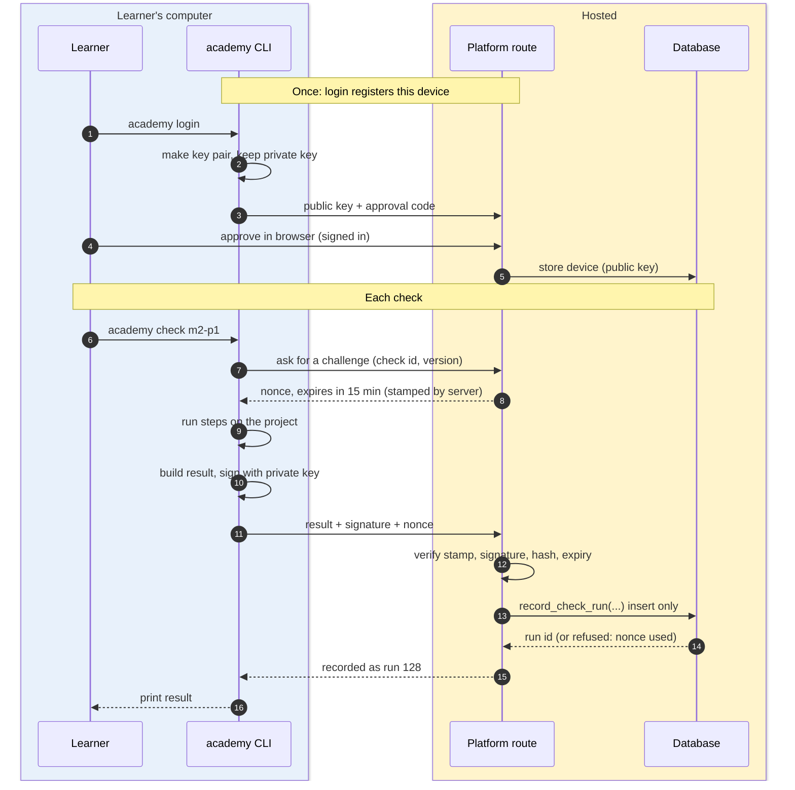

# Checker — the local CLI

Read `decisions.md` (ADR-3) and `platform.md` first. This is a plan; it contains no code.

The checker is a small Node/TypeScript command-line tool named `academy`. It runs on the
learner's machine (WSL 2), checks the learner's project, and sends a **signed result** to the
platform. It never sends source code.

## How the learner uses it

Everything happens in the VS Code terminal, opened in the project folder inside WSL.

| Step | Command | What happens |
| :--- | :--- | :--- |
| Once | `npx academy doctor` | Confirms WSL, Node, Git and (if needed) the lab database connection |
| Once | `npx academy login` | Shows a short code and a link; the learner approves it in the browser; the device is registered |
| Each project | `npx academy check m2-p1` | Runs the checks, prints pass or fail with reasons, sends the result |
| Any time | `npx academy check m2-p1 --dry-run` | Same checks, nothing sent |
| Any time | `npx academy status` | Shows what the platform has recorded |

The task page on the platform shows the exact command to copy. A VS Code task
(`.vscode/tasks.json`, created by `academy init`) runs the same command from the Run Task
menu. Output is plain text: one line per check, then a summary.

```text
m2-p1 · Grading scale · check v1.2.0
  PASS  files    src/lib/grading.ts exists
  PASS  static   eslint, tsc
  FAIL  tests    7 of 9 passed
          score 79 → expected "Higher", got "High"
          score 100 → expected "Highest", got error
  PASS  git      4 commits, clear messages
Result: NOT PASSED · sent to platform (run 128)
```

## How a check is defined

Checks are **versioned files in this repo**, reviewed like any other change.

```text
checks/
  m2/p1/
    check.yaml        what to run, in order
    tests/            the test files the checker runs against the learner's code
    fixtures/         sample inputs and expected outputs
  manifest.json       every check: version and sha256 of its folder
```

`check.yaml` lists steps. Each step uses one of the seven check kinds from `curriculum.md`:

| Field | Meaning |
| :--- | :--- |
| `id`, `title` | The project slug (`m2-p1`) and its name |
| `version` | Semantic version; any change to the folder needs a new version |
| `requires` | What must exist first: `node`, `lab-db`, `docker` (only for **[Docker]** labs) |
| `steps[]` | `kind` (`files`, `tests`, `static`, `git`, `sql`, `page`, `doc`), its settings, and whether it is required |
| `pass` | The rule for the whole project, normally "all required steps pass" |

Rules for check files:

- A step only **reads and runs**; it never changes the learner's files or database rows
  outside a scratch schema it creates and drops.
- `sql` steps use the connection in the learner's `.env`; the checker refuses a connection
  that is not the learner's lab project.
- `manifest.json` is rebuilt by a script. The content build publishes it to
  `check_definitions`. The platform accepts a run only for a published version and hash.
- An old version stays valid for results already recorded. New runs must use the current
  version; the CLI says "update the checker" when it is behind.

## How results reach the platform



### What is in a result

| Field | Why |
| :--- | :--- |
| Check id, version, sha256 of the check folder | Proves which check ran |
| Nonce from the platform | One result per challenge; stops replays |
| Git commit SHA and whether the tree was clean | Ties the result to a state of the project |
| Per-step outcome and short reason | What the learner sees on the platform |
| Checker version, start and end time | For diagnosis |
| Device id and signature | Who sent it, and that it was not changed on the way |

No source code, no file contents, no database rows. Failure reasons are short text produced by
the check, cut to a fixed length.

### The signing scheme (simple, standard parts)

1. **Device key.** `academy login` makes an Ed25519 key pair. The private key stays in the
   learner's home folder (file mode 600). The public key is stored in `devices` after the
   learner approves the device while signed in on the platform.
2. **Challenge.** Before running, the CLI asks for a nonce. The platform returns a random
   nonce with the user, check and expiry, and an HMAC "stamp" made with a server-only key.
   Nothing is stored yet.
3. **Signature.** The CLI signs the exact bytes of the result (canonical JSON) with the
   device key.
4. **Verification, on the server only.** The platform route checks: the stamp is its own and
   not expired; the device belongs to the signed-in user and is not revoked; the signature
   matches; the check version and hash are published; the result fits the schema.
5. **Recording.** The route calls `record_check_run()`. The table has no insert policy, so
   this function is the only way in. It checks a second stamp from the route (HMAC with a key
   the database holds in a table no role can read), then inserts. `nonce` is unique, so the
   same result cannot be recorded twice. Rows cannot be updated or deleted (`platform.md`).

All traffic is HTTPS. The server-only key lives in the hosting environment's settings, never
in the repo and never in client code. A learner can revoke a device on the platform; its
later results are refused.

### What this stops

- Editing a result on the way to the platform, or typing a "pass" into the database.
- Sending the same passing result twice, or for another project.
- Sending a result as another learner, or from a device that was revoked.
- Claiming a pass against an old or changed check.

## What a local checker cannot prevent

This must be said plainly: **the learner controls the machine the checker runs on.**

- A learner can change the checker, or write their own program that signs a "pass" with
  their own device key. The signature proves *which device* sent a result. It does not prove
  that the checks really ran.
- The tests ship with the checker, so a learner can read them and write code that satisfies
  the tests without solving the problem.
- A learner can copy from GPIS, or have someone (or an AI) write the code. No local tool can
  see that.
- The commit SHA is reported by the same machine; it is evidence, not proof.

Why this is acceptable now: there is one learner, and cheating only cheats that learner. The
signature and nonce protect the **record** from accidents and casual edits; they are not an
exam hall.

What supports honesty without more machinery:

- The mastery check asks for an explanation and a comparison with GPIS (self-assessed).
- Debugging labs change between versions, so remembered answers do not pass.
- `academy check --at <commit>` re-runs a check on an old commit, to confirm a past result.

If results ever need to be trusted by someone else (certificates, a cohort), the right step is
to **re-run the checks on a server the learner does not control**, for example in CI on the
learner's repository, and to record that result instead. That is postponed (ADR-3).

## Not in the first version

| Left out | Why |
| :--- | :--- |
| Running checks on a server or in CI | Postponed until results must be trusted by others |
| A VS Code extension | A terminal command and a VS Code task are enough |
| Auto-fixing or hints written by AI | ADR-3 |
| Uploading code, logs or screenshots | The platform stores results only |
| Windows-native support | WSL 2 is required from Module 1 |
