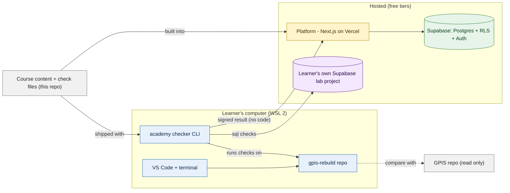
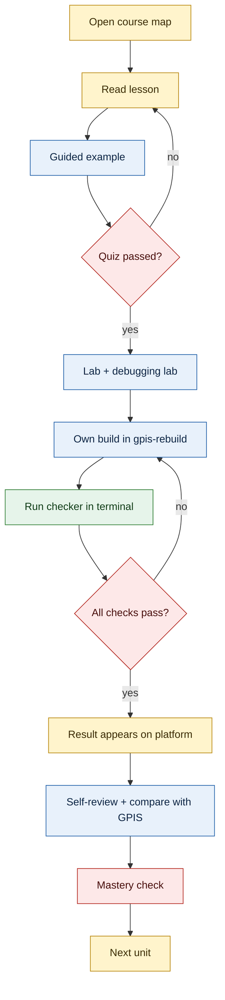
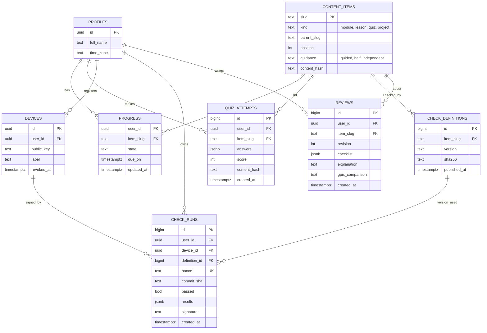

# Platform — the minimal study tool

Read `decisions.md` and `curriculum.md` first. This is a plan; it contains no application code.

The platform is small on purpose (ADR-1, ADR-3). It shows the course, records what the learner
did, and receives results from the local checker (`checker.md`). It never runs learner code.

- **Stack:** Next.js 16 (App Router), TypeScript strict, Supabase (PostgreSQL, RLS, Auth),
  Tailwind CSS v4, shadcn/ui. Runs locally, then on the Vercel free tier.
- **Users:** one learner now. The data model already keeps each learner's rows separate, so a
  second learner needs no redesign.
- **Rules carried over from GPIS:** RLS on every table; role from `app_metadata`; no secret or
  service-role key in `src/`; every schema change is a migration; mobile-first at 360px with
  44px touch targets.

## System overview



## MVP features

| Feature | What the learner can do |
| :--- | :--- |
| Course map | See all modules in order, what is done, what is next, and the guidance level |
| Lessons | Read a lesson (Markdown from the repo), mark it read |
| Quizzes | Answer a short retrieval quiz; see the score; retry (every attempt is kept) |
| Project tasks | Read the task, the hints (if the level allows), and the exact checker command |
| Checker results | See each run sent by the CLI: pass or fail per check, with the reason |
| Self-review | Tick the review checklist and write the short explanation and GPIS comparison |
| Progress | Four separate facts per project: complete, correct (checker), reviewed (self), on time |
| Sign in | Email and password (Supabase Auth); connect the CLI to the account |

Course content is **files in this repo**, not database rows the learner edits:
`content/module-NN/unit-NN/` holding `lesson.md`, `quiz.json`, `lab.md` and the rest (the
template is `content/module-01/unit-01/`). A build step lists them into
`content_items` so that progress rows can point at something real.

## Learner journey



## Data model (8 tables)

| Table | Purpose | Changes allowed |
| :--- | :--- | :--- |
| `profiles` | One row per learner (name, time zone) | Own row: read, update name |
| `content_items` | Index of modules, units and projects, built from the repo | Read only for learners; written by the content build |
| `progress` | Current state of one item for one learner (read, quiz passed, …) | Own rows: insert, update |
| `quiz_attempts` | One row per quiz attempt: answers, score, content version | **Insert only** |
| `devices` | A registered checker install: public key, name, revoked or not | Own rows: read, revoke |
| `check_definitions` | Published check versions: project, version, file hash | Read only |
| `check_runs` | One row per checker run received: results, commit, signature | **Insert only, through one function** |
| `reviews` | Self-review revisions: checklist, explanation, GPIS comparison | **Insert only** (a change is a new revision) |



### Row-Level Security

RLS is on for every table, with no policy until one is written (deny by default).

| Table | Select | Insert | Update | Delete |
| :--- | :--- | :--- | :--- | :--- |
| `profiles` | own row | by a sign-up trigger | own row | never |
| `content_items` | any signed-in user | never (content build only) | never | never |
| `progress` | own rows | own rows | own rows | never |
| `quiz_attempts` | own rows | own rows; score is computed by the server | never | never |
| `devices` | own rows | by the device-registration function | own rows: set `revoked_at` only | never |
| `check_definitions` | any signed-in user | never (content build only) | never | never |
| `check_runs` | own rows | **no policy**; only `record_check_run()` inserts | never | never |
| `reviews` | own rows | own rows | never | never |

"Own" always means `user_id = auth.uid()`. The content build runs as a migration-style script
with the database owner's connection, from the developer's machine or CI, never from `src/`.

### Immutable attempts

`quiz_attempts`, `check_runs` and `reviews` are history. Three layers keep them unchanged:

1. **Privileges:** `UPDATE` and `DELETE` are not granted to `authenticated` on these tables.
2. **Policies:** there is no update or delete policy.
3. **Trigger:** a `BEFORE UPDATE OR DELETE` trigger raises an error for every role, so a later
   mistake in grants cannot open them.

A quiz score is never sent by the browser. A Server Action reads the answers, marks them
against `quiz.json` on the server, and inserts the attempt with the score.

`progress.state` for a project is **derived** when it is read: "correct" means a passing
`check_runs` row exists for the current check version; "reviewed" means a `reviews` row
exists. The learner cannot set those two by hand.

## Folder structure

```text
gpis-academy/
  docs/                    decisions, curriculum, platform, checker, mockups
  content/                 the course (original lessons only); see content/README.md
    module-01/
      unit-01/             unit.md  lesson.md  example.md  quiz.json  lab.md
                           debugging-lab.md  own-build.md  review.md
        check/             check.yaml  fixtures/   (the lab's check; see checker.md)
    index.json             built: every module, unit and project
    manifest.json          built: version and hash of every check
  packages/
    checker/               the CLI (Node/TypeScript), published as `academy`
    shared/                types and result schema used by CLI and platform
  apps/
    web/                   the platform
      src/app/             (public) landing · (auth) sign in · (app) map, lesson, project, progress
      src/app/api/         check-runs, device registration
      src/components/      shadcn/ui components and screen parts
      src/lib/             content loader, progress rules, signature checks
  supabase/
    migrations/            every schema change
  scripts/                 content build, offline tests
```

## Not in the MVP

| Left out | Why |
| :--- | :--- |
| Hosted terminals, sandboxes, in-browser editor | ADR-3; the learner's own terminal and VS Code |
| AI tutor, chat, RAG | ADR-3 |
| Cohorts, teams, mentors, review queues, peer review | One learner; self-review only (ADR-5) |
| Admin screens and a content editor | Content is files in the repo, changed with Git |
| Payments, certificates, badges, leaderboards | Not needed to learn |
| Analytics dashboards, weekly reports, recommendations | One progress page is enough |
| Portfolio or blog generator | The learner builds their own site (project 3.1) |
| Mobile app, offline mode, push or email notices | A responsive site is enough |
| Background jobs, queues, caches | Nothing here is slow enough to need them |
| Discussion, comments, notes | Out of scope for a study tool |
| Running or storing the learner's code | The platform stores results only, never code |
